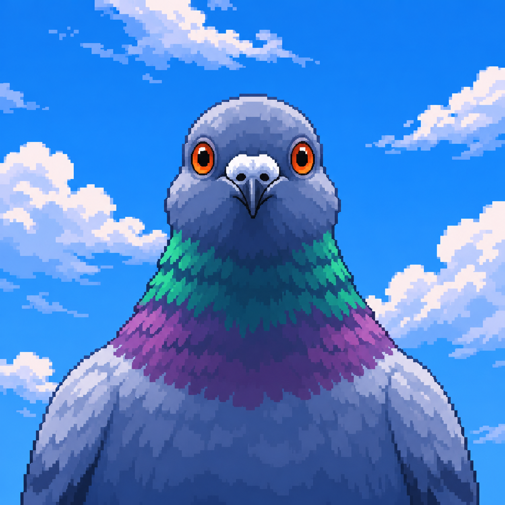
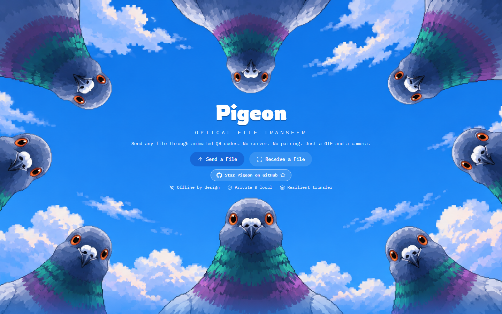
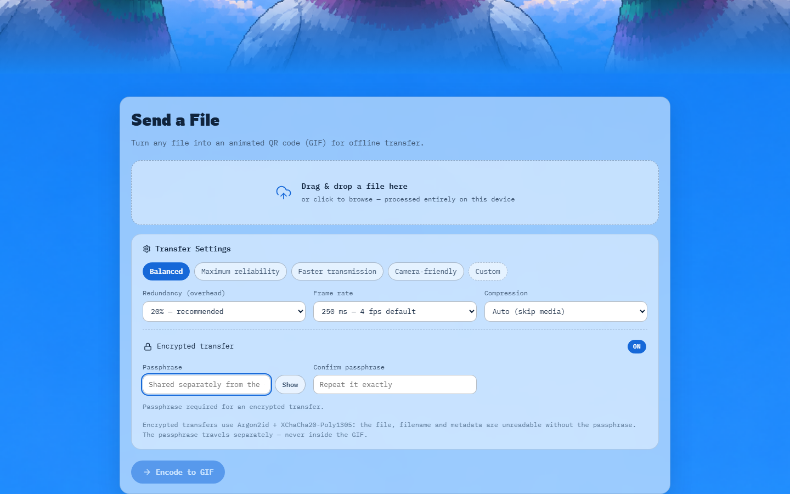

<div align="center">



# Pigeon

**Offline-first optical file transfer.**

Pigeon turns a file into an animated QR-code GIF that travels through any
ordinary file-sharing channel — and is reconstructed **byte-for-byte** on
another device. No network. No server. No account. No pairing.

[**⭐ Star this repository**](https://github.com/Rudrakshbhardwaj01/Pigeon) ·
[Report an issue](https://github.com/Rudrakshbhardwaj01/Pigeon/issues)


</div>

---

```text
┌─────────┐   file    ┌──────────────────┐    GIF as a document     ┌─────────┐
│  Sender │──────────▶│ animated QR GIF  │─────────────────────────▶│Receiver │
│  device │           │ (loops forever)  │  WhatsApp / Telegram /   │ device  │
└─────────┘           └──────────────────┘  e-mail / Drive / USB    └────┬────┘
                                                                        │ import
                                                                        ▼
                                                              ┌──────────────┐
                                                              │   original   │
                                                              │  SHA-256 ✓   │
                                                              └──────────────┘
```

The name is the concept: a carrier pigeon carries the message on its own,
without infrastructure.

## What is Pigeon?

A file is fragmented and fountain-coded (RaptorQ, RFC 6330), each packet is
rendered as a QR code, and the codes become the frames of an animated GIF.
That GIF is the transfer: send it anywhere a file can go. On the receiving
device, Pigeon decodes the frames, collects the packets in any order,
reconstructs the file, and verifies its SHA-256 against the manifest carried
inside the transfer. The download is offered **only** when the bytes match.

Because everything is encoded ahead of time, the receiving device needs no
connectivity to the sender — the GIF itself is the entire channel. That makes
Pigeon useful for air-gapped devices, offline hand-offs, and situations where
installing an app or joining a network is not an option.

## How it works

```mermaid
flowchart LR
    subgraph Sender
        A[File] --> B["Rust core: compress + fragment + RaptorQ fountain encode"]
        B --> C["Wire packets (20-byte header + CRC32C)"]
        C --> D[QR frames via fast_qr]
        D --> E[Animated GIF, two-colour palette]
    end
    E -- "any file channel" --> F[Animated GIF]
    subgraph Receiver
        F --> G["Streaming GIF parse or camera frames"]
        G --> H[QR decode via ZXing WASM]
        H --> I["Rust core: validate + dedupe + RaptorQ decode"]
        I --> J[SHA-256 verify]
        J --> K[File download, byte-for-byte]
    end
```



Two independent layers of redundancy protect the transfer:

- **Inside a frame** — QR error correction tolerates damaged pixels.
- **Across frames** — the fountain code tolerates *lost or undecodable
  frames*: any sufficient subset of unique packets rebuilds the file, in any
  order, with duplicates ignored.

## Features

Implemented and verified by automated tests (native Rust + real-browser E2E):

- **File → GIF → file** roundtrip, byte-exact, SHA-256 verified.
- **GIF import** (streaming parse, bounded memory) and **camera receiving**
  (live scanning, frames in any order).
- **RaptorQ forward error correction** with user-selectable redundancy
  (10–100 % overhead).
- **Optional zlib compression** with an auto heuristic that skips
  already-compressed media; decompression is hard-bounded.
- **Self-describing transfers**: metadata packet (filename, size, MIME,
  SHA-256, FEC parameters) re-emitted every 500 frames so late joins learn
  the parameters.
- **Multi-transfer isolation**: random 64-bit transfer ids; transfers never
  mix, duplicates and corruption are counted, not fatal.
- **Fully offline PWA**: the app shell, Rust/WASM engine and QR decoder are
  bundled and precached — verified by an automated test that performs a
  complete transfer with the network disabled.
- **Local-first by construction**: strict CSP with no remote origins, no
  telemetry, no accounts.
- **Honest UI**: real progress (unique/required packets), explicit
  incomplete-transfer reports, terminal integrity failures — no partial or
  "probably fine" files.

Not implemented (by design or yet): encryption/authentication of transfers
(the GIF is plaintext), a receiver→sender feedback channel, and native
mobile shells. See the [roadmap](#roadmap).

## Screenshots

| | |
|---|---|
|  |  |

*More views: [docs/img](docs/img).*

## Architecture

Rust owns correctness. The entire engine — protocol framing, CRC32C,
metadata + filename sanitization, RaptorQ FEC, QR generation, GIF
encode/parse, compression, SHA-256 verification and the multi-transfer
recovery state machine — lives in
[`crates/pigeon-core`](crates/pigeon-core/src), is compiled to WebAssembly
by [`crates/pigeon-wasm`](crates/pigeon-wasm/src/lib.rs), and runs inside
Web Workers. The browser handles only what a browser must: camera access,
canvas rendering and file APIs. QR *decoding* uses ZXing WASM
(self-hosted — the `.wasm` binary is bundled, never fetched from a CDN),
and every decoded payload is re-validated by the Rust core.

```text
apps/web (React + TypeScript, Vite)
├── SendPage ────▶ encode.worker ──▶ pigeon_wasm (Rust → WASM)
├── ReceivePage ─▶ decode.worker ──▶ pigeon_wasm ┘ + ZXing (QR decode)
└── camera scan ─▶ camera.worker ──▶ ZXing only; bytes go to decode.worker
                                     so the Rust core validates everything
```

- **Protocol**: 20-byte header (magic, version, flags, transfer id, length,
  CRC32C) + payload. Full wire spec: [`docs/PROTOCOL.md`](docs/PROTOCOL.md).
- **Offline**: custom service worker (`apps/web/src/sw.ts`) precaches the
  entire build (including both `.wasm` binaries) with Vary-free responses;
  navigation falls back to the cached `index.html`.
- Details and data-flow contracts:
  [`docs/ARCHITECTURE.md`](docs/ARCHITECTURE.md).

## Installation

Prerequisites:

- **Node.js ≥ 20** with npm (the only package manager; npm workspaces wire
  the root to `apps/*`).
- Optional, only to regenerate the WASM engine from the Rust crates:
  [Rust](https://rustup.rs/) with `rustup target add wasm32-unknown-unknown`
  and [wasm-pack](https://rustwasm.github.io/wasm-pack/). The compiled
  engine is committed at `apps/web/src/wasm/pigeon-wasm/`, so Rust is **not**
  required to build or run the app.

```sh
git clone https://github.com/Rudrakshbhardwaj01/Pigeon
cd Pigeon
npm install
npm run dev          # http://127.0.0.1:5173
```

Production build and local preview:

```sh
npm run build        # → apps/web/dist
npm run preview      # serves dist at http://127.0.0.1:4173
```

Regenerating the WASM engine (requires the Rust toolchain):

```sh
npm run build:wasm
```

## Usage

**Send**

1. Drop any file into the Send section (or click to browse).
2. Choose redundancy, frame rate and compression — defaults are sensible.
3. *Encode to GIF* → *Download GIF*. The stats panel shows frame count,
   redundancy, QR version/ECL, loop duration and the SHA-256.

**Transport**

Send the GIF as a **document / file attachment** (WhatsApp document,
Telegram file, e-mail, Drive, USB). Platforms that re-encode media as video
damage frames; the built-in redundancy tolerates some loss, but an untouched
file is always safest.

**Receive**

- *Import a GIF*: drop the GIF into the Receive section. Frames are decoded
  locally, one at a time. Reconstruction and SHA-256 verification are
  automatic; the download appears only when verification succeeds.
- *Scan with camera*: point the receiving camera at a screen playing a
  Pigeon GIF (open the GIF in any image viewer and let it loop). Frames
  arrive in any order; progress shows unique/required packets. Requires
  HTTPS or localhost.

**Limits to understand before transferring**

- Optical throughput is modest: ≈ 3 KiB/s at the default 4 fps. Pigeon is
  aimed at small, high-value payloads (keys, configs, small documents).
- GIF size grows ≈ 24 KiB/frame at ~700 px frames — a 1 MiB file with 30 %
  redundancy produces ≈ 30 MB of GIF.
- The encoder defaults to 64 MiB input (configurable up to the 256 MiB
  engine cap); whole-object FEC requires the payload in memory.
- Camera scanning requires HTTPS or localhost (browser policy).

## Privacy and security

- Files are processed entirely in your browser. Nothing is uploaded; this is
  enforced by CSP (`connect-src 'self'`) and verifiable in the bundle — the
  app makes **no** remote requests at runtime, even offline assets come from
  the local cache.
- CRC32C detects corruption; SHA-256 establishes content identity. **Neither
  authenticates the sender, and Pigeon does not encrypt** — anyone holding
  the GIF holds the file. Treat the GIF as the secret itself.
- All imported GIFs and packets are treated as hostile input: signature and
  dimension checks, streaming parse, packet CRC and length limits, bounded
  decompression, filename sanitization, unknown-version rejection.

Read the honest details: [`docs/SECURITY.md`](docs/SECURITY.md) and
[`docs/THREAT_MODEL.md`](docs/THREAT_MODEL.md).

## Browser compatibility

| Browser | GIF import | Camera receiving | Offline PWA |
|---|---|---|---|
| Chromium/Chrome (desktop & Android) | ✅ tested | ✅ init tested (fake stream); no real-device scan yet | ✅ tested |
| Firefox | expected to work (standard APIs) | untested | untested |
| Safari | expected to work (standard APIs) | untested | untested |

Camera access requires a secure context (HTTPS or localhost) and a
user-granted permission. Automated coverage runs on Playwright's Chromium
with a fake media stream; real-device camera scanning has not been exercised
in this delivery.

## Development

```sh
npm run test:rust    # Rust unit + native optical roundtrip suites
npm run test:web     # Vitest unit/component tests
npm run test:e2e     # Playwright: real-browser roundtrips incl. offline
npm run typecheck    # tsc -b
npm run lint         # eslint

# release-mode benchmarks (real measurements; see docs/BENCHMARKS.md)
cargo test -p pigeon-core --release --test bench -- --ignored --nocapture
```

The end-to-end suite exercises the complete pipeline in a real browser —
file → GIF → download → import → verified reconstruction → byte comparison —
plus offline operation, incomplete-transfer reporting and invalid-input
handling. Project structure:

```text
crates/pigeon-core/      Rust engine (protocol, FEC, QR, GIF, recovery)
crates/pigeon-wasm/      wasm-bindgen API surface
apps/web/                React app, workers, service worker, tests
docs/                    protocol, architecture, security, threat model…
tests/fixtures/          shared E2E fixtures
```

Contributions are welcome — please open an issue or pull request on
[GitHub](https://github.com/Rudrakshbhardwaj01/Pigeon).

## Troubleshooting

- **"This browser does not expose the camera API"** — camera scanning needs
  HTTPS or localhost; also check the browser's site permissions.
- **"Not enough frames captured yet"** — the GIF was incomplete (some frames
  lost or altered in transit). Send GIFs as documents/files, not as media
  that platforms may re-encode; then re-import.
- **"No Pigeon packets found in this GIF"** — the file is not a Pigeon
  transfer (or its frames were modified). Verify it was produced by Pigeon's
  Send tab.
- **Encoding fails on a large file** — the default input limit is 64 MiB;
  whole-object FEC needs the payload in memory.
- **The app does not work offline** — the service worker caches the app on
  first load; do one online load first, then go offline. If a previous
  install misbehaves, clear the site's storage (the cache version handles
  upgrades automatically).

## License

MIT — see [LICENSE](LICENSE).

## Acknowledgements

Pigeon's design was informed by studying three prior projects —
[TXQR](https://github.com/divan/txqr) (the original animated-QR + fountain
concept), [RaptorQR](https://github.com/infrost/RaptorQR) (protocol and
performance reference) and [AirQR](https://github.com/Thunzyy/AirQR) (the
closest product reference) — without copying code from any of them. Study
notes: [`docs/REFERENCE_RESEARCH.md`](docs/REFERENCE_RESEARCH.md).
Dependency licenses: [`apps/web/THIRD_PARTY_LICENSES.md`](apps/web/THIRD_PARTY_LICENSES.md).

## Roadmap

1. Physical-device camera testing and tuning (Android Chrome, iOS Safari).
2. Optional authenticated encryption via the reserved protocol flag space.
3. Native shells reusing the environment-neutral Rust core (FFI).
4. Optional, explicit receiver feedback channel.

---

<div align="center">

**Made by [Rudraksh Bhardwaj](https://rudrakshbhardwaj.vercel.app/)**

⭐ [Star Pigeon on GitHub](https://github.com/Rudrakshbhardwaj01/Pigeon)

</div>
